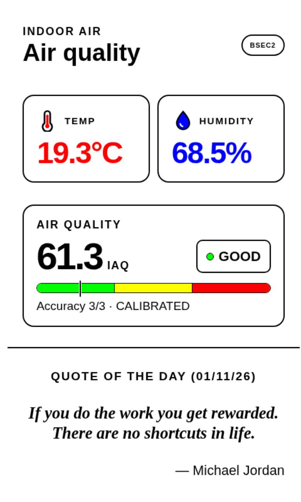

# Sensor & Quote Plugin for InkyPi

This plugin for InkyPi displays ambient sensor data and an inspirational Zen quote. 

## Features

This plugin is an extension for the [InkyPI](https://github.com/fatihak/InkyPi) e-paper display frame and includes the following features:

*   **Sensor Data Display:** Shows readings from a temperature and humidity sensor, such as a BME680.
*   **Inspirational Quote:** Displays a random Zen quote alongside the sensor data.
*   **Flexible Data Sourcing:** You can choose how to get your sensor data:
    *   **Remote (SSH):** Fetch sensor data from a device on your network.
    *   **Local (File):** Read sensor data directly from a local file.

    
## Install

Install the plugin using the InkyPi CLI, providing the plugin ID and GitHub repository URL:

```bash
inkypi plugin install sensor_quote https://github.com/rs9000/inkypi-plugin-sensor-quote
```

## JSON Data Format

The plugin accepts both the compact format below and BSEC2 output. For BSEC2,
it uses the formatted readings and labels when present, and falls back to the
numeric `temperature_c`, `humidity_percent`, and `air_quality_score_value`
fields. The optional `iaq_calibration` text is shown below the air quality
reading.

```json
{
    "temperature": "22.0°C",
    "humidity": "56.8%",
    "air_quality_score": "74.1",
    "air_quality_label": "GOOD"
}
```

### Example BSEC2 output

The following is an example of the JSON produced by a sensor using the Bosch
BSEC2 algorithm:

```json
{
  "temperature": "21.1°C",
  "temperature_c": 21.13,
  "humidity": "78.7%",
  "humidity_percent": 78.73,
  "pressure": "1017.3 hPa",
  "gas_resistance": "331385 Ohm",
  "co2_equivalent_ppm": 1315.2,
  "co2_accuracy": 3,
  "breath_voc_equivalent_ppm": 3.18,
  "breath_voc_accuracy": 3,
  "gas_label": "CALIBRATED",
  "gas_label_class": "gas-ottimo",
  "air_quality_score": "139.8",
  "air_quality_score_value": 139.81,
  "air_quality_label": "LIGHTLY POLLUTED",
  "air_quality_class": "iaq-band-3",
  "iaq_accuracy": 3,
  "iaq_calibration": "Accuracy 3/3 · CALIBRATED",
  "air_quality_algorithm": "BSEC2",
  "altitude": "-33.26 meters"
}
```

The BSEC2 JSON can also include `gas_resistance`, `co2_equivalent_ppm`,
`breath_voc_equivalent_ppm`, `gas_label`, `air_quality_class`,
`iaq_accuracy`, `iaq_calibration`, and `air_quality_algorithm`. The current
display uses temperature, humidity, air quality score, air quality label, and
the optional calibration text. Air quality labels such as "CLEAN AIR",
"GOOD", "LIGHTLY POLLUTED", "POLLUTED", and "BAD" are mapped to colors.

## Example on e-ink display

Preview of the BSEC2 layout on a Spectra 6 e-ink display:


